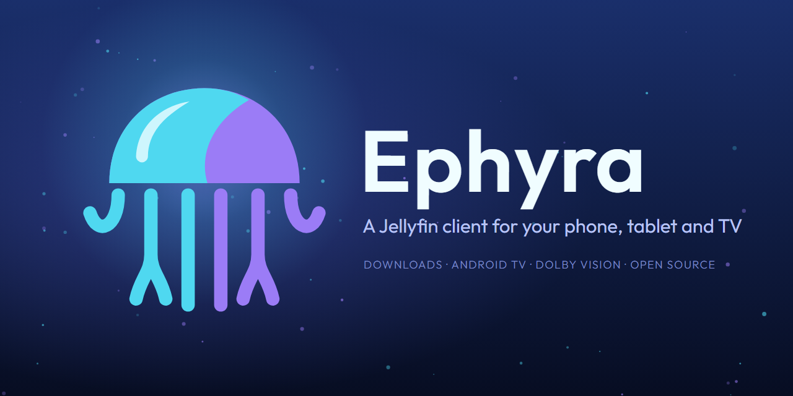
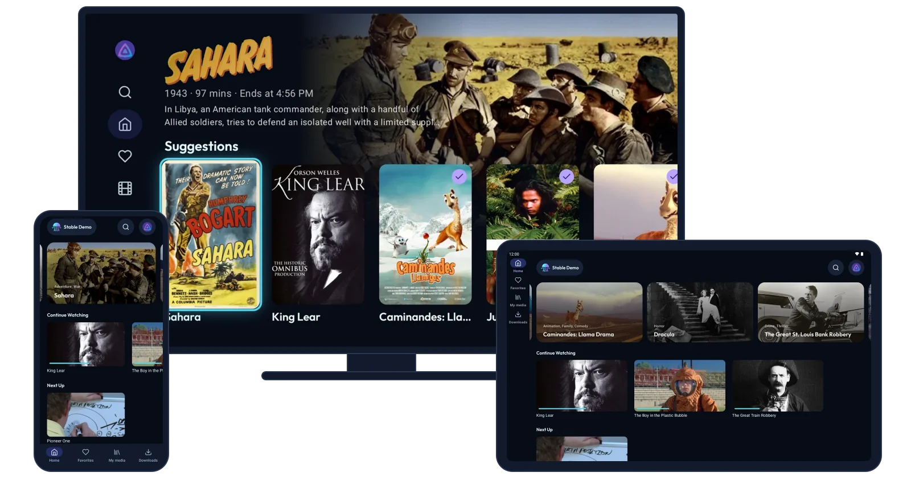
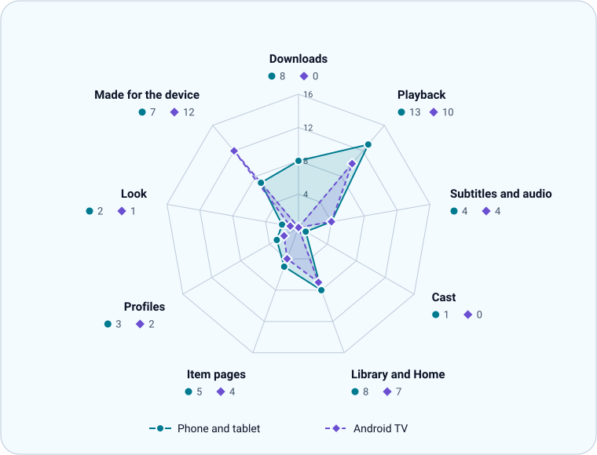
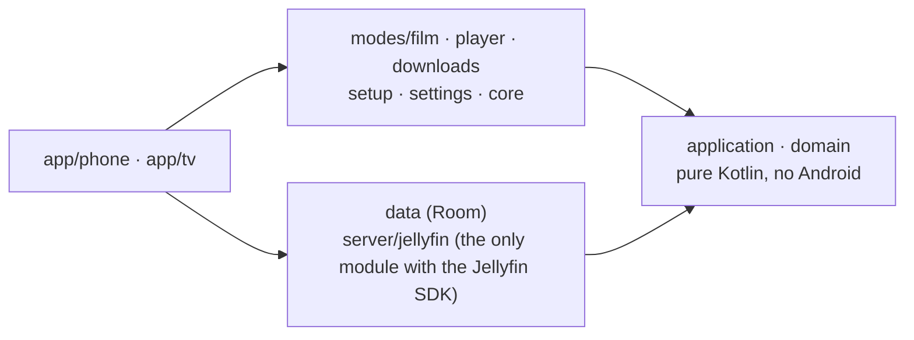

<p align="center">
  
</p>

<p align="center">
  <a href="https://github.com/midasvo/ephyra/releases/latest"></a>
  <a href="https://github.com/midasvo/ephyra/releases"></a>
  <a href="https://jellyfin.org/"></a>
  <a href="LICENSE"></a>
</p>
<p align="center">
  <a href="https://midasvo.nl/ephyra/">Website</a> ·
  <a href="https://midasvo.nl/ephyra/guide/">Guide</a> ·
  <a href="#install">Install</a> ·
  <a href="#what-you-get">What you get</a> ·
  <a href="#what-runs-where">What runs where</a> ·
  <a href="#under-the-hood">Under the hood</a> ·
  <a href="https://midasvo.nl/ephyra/dev/">Developing</a>
</p>

Ephyra plays the movies and series of your own [Jellyfin](https://jellyfin.org/) server on
Android phones, tablets and Android TV.

- **Downloads worth using.** Resumable, in a quality you choose, whole series at once, and they
  play when the server can't be reached.
- **Plays what you have.** Dolby Vision, Atmos, image subtitles and more than one version of a
  film, without the server converting what your device can play itself.
- **Made for each screen.** One phone app that lays itself out for a tablet or a foldable, and a
  separate TV app built for the remote.

Free, GPLv3, and it collects nothing. It is a fork of
[Findroid](https://github.com/jarnedemeulemeester/findroid) and needs Jellyfin 12.0 or newer and
Android 10 or newer (Android 9 on TV).

<p align="center">
  <a href="https://midasvo.nl/ephyra/guide/"></a>
</p>

## Install

| | How | Updates |
|---|---|---|
| **Obtainium** | Add `https://github.com/midasvo/ephyra` and set the APK filter for your device | Obtainium finds them; you confirm the install |
| **Releases** | Download the APK from [Releases](https://github.com/midasvo/ephyra/releases/latest) | By hand |
| **F-Droid** | Not yet: [submitted](https://gitlab.com/fdroid/fdroiddata/-/merge_requests/56048), waiting for review | |

Phones and tablets take a `-libre-` file, or `-proprietary-` for Google Cast; Android TV takes a
`-libre-tv-` file. The **[install guide](https://midasvo.nl/ephyra/guide/install/)** has the
Obtainium filter per device, the two variants and the stores. Every change is also published as
a [beta](https://midasvo.nl/ephyra/guide/beta/) that installs next to the stable app. Coming
from Findroid CE, the update installs over it and
[keeps everything](https://midasvo.nl/ephyra/guide/findroid/#moving-over).

## What you get

### Downloads

A quality per download, from the original down to 360p. Whole seasons or only the unwatched
episodes, to internal storage or an SD card. Smart Downloads keeps the next episodes ready. There
is no offline mode to switch on: downloads just play, and what you watched is sent to the server
when it is back. **[More about downloads →](https://midasvo.nl/ephyra/guide/downloads/)**

<table>
  <tr>
    <td width="33%" align="center"><br><sub>Downloads, with a storage breakdown</sub></td>
    <td width="33%" align="center"><br><sub>Progress per episode</sub></td>
    <td width="33%" align="center"><br><sub>Every download asks for a quality</sub></td>
  </tr>
</table>

### Playback

Dolby Vision played directly where the device can, converted where it can't. A version picker
before playing, a quality switch during it, and a default quality for Wi-Fi and one for mobile
data. Intros and credits skipped, asked or left alone,
per kind. An "Up next" card, a sleep timer, and subtitles you can style and put back in sync,
with your audio and subtitle choice remembered per series.
**[Playback →](https://midasvo.nl/ephyra/guide/playback/)** ·
**[Subtitles and audio →](https://midasvo.nl/ephyra/guide/subtitles-and-audio/)**

<p align="center">
  
  
</p>

### Cast

Pick a Chromecast from the top bar and the phone becomes the remote, with a mini player while
you browse. In the proprietary variant, on phones and tablets.
**[Cast →](https://midasvo.nl/ephyra/guide/cast/)**

<table>
  <tr>
    <td width="33%" align="center"><br><sub>Pick a device from the top bar</sub></td>
    <td width="33%" align="center"><br><sub>The phone becomes the remote</sub></td>
    <td width="33%" align="center"><br><sub>A mini player while you browse</sub></td>
  </tr>
</table>

### Tablet and foldable

The phone app, laid out for the window: a navigation rail, item pages in two columns, seasons as
list and detail, an episode panel in the player, keyboard and mouse, and tabletop mode on a
foldable. **[Tablet →](https://midasvo.nl/ephyra/guide/tablet/)**

<p align="center">
  
  
</p>

### Android TV

A separate app for the remote: a Home with a hero for the focused item, a library grid with a
jump bar, trickplay thumbnails while seeking, refresh rate switching, Watch Next on the Android
TV home screen and a screensaver with your library's artwork.
**[Android TV →](https://midasvo.nl/ephyra/guide/tv/)**

<p align="center">
  
  
</p>

And more: profiles with a PIN, Home rows you choose, hide watched, hide spoilers, fuller movie and
show pages, ratings from IMDb, Rotten Tomatoes, Metacritic and Letterboxd (opt-in, with your own
MDBList key), and a look of its own.
**[Library and Home →](https://midasvo.nl/ephyra/guide/library/)** ·
**[Profiles →](https://midasvo.nl/ephyra/guide/profiles/)** ·
**[Look →](https://midasvo.nl/ephyra/guide/look/)**

<sub>Screenshots use the public-domain library of the Jellyfin demo server, except the download screens: the demo account can't download, so those come from the maintainer's server. All artwork shown belongs to its respective owners.</sub>

## What runs where

The number of things Ephyra adds to Findroid, per area, in the phone and tablet app and in the
TV app. The TV app has no downloads and no Cast; it has the most that is made for its own
screen.

<p align="center">
  <a href="https://midasvo.nl/ephyra/guide/devices/">
    <picture>
      <source media="(prefers-color-scheme: dark)" srcset="images/readme/radar-dark.svg">
      
    </picture>
  </a>
</p>

The chart is drawn from [docs/features.yaml](docs/features.yaml), one entry per feature.
**[Every feature per device →](https://midasvo.nl/ephyra/guide/devices/)**

## Ephyra and Findroid

Ephyra is a fork of [Findroid](https://github.com/jarnedemeulemeester/findroid) by
[Jarne Demeulemeester](https://github.com/jarnedemeulemeester) and its
[contributors](https://github.com/jarnedemeulemeester/findroid/graphs/contributors), and was
called Findroid CE until 2.0.0. It stays 0 commits behind Findroid: translations are merged in,
and each code change is judged and, where it is worth having, built again in Ephyra's own
structure. The [upstream ledger](docs/upstream-ledger.md) lists every Findroid commit with what
Ephyra did with it and why; the [changelog](CHANGELOG.md) has every release.
**[Ephyra and Findroid →](https://midasvo.nl/ephyra/guide/findroid/)**

## Under the hood



- **Ports and adapters, enforced by the build.** Eighteen architecture rules run with the unit
  tests; a screen cannot reach the Jellyfin SDK or the database around a port.
- **Two player engines**, ExoPlayer and mpv, behind one interface.
- **Translated in 36 languages**, checked on every pull request
  ([how the translations work](https://midasvo.nl/ephyra/guide/findroid/#translations)).
- **Reproducible builds**, verified against the published APKs.

The **[development site](https://midasvo.nl/ephyra/dev/)** has the
[architecture model](https://midasvo.nl/ephyra/dev/architecture/model/) to click through, a
guide per area of the code and every decision record.

## Bugs and contributions

[Open an issue](https://github.com/midasvo/ephyra/issues). For playback problems, attach the
device profile from About → Export device profile.

Pull requests are welcome: [CONTRIBUTING.md](CONTRIBUTING.md) has the build, the checks and the
conventions. With JDK 21 and the Android SDK, this builds the phone app:

```bash
./gradlew :app:phone:assembleLibreDebug
```

## Privacy

Ephyra collects nothing. It talks to the Jellyfin servers you add, and to MDBList only if you
switch on external ratings.
[Privacy policy](https://midasvo.nl/ephyra/privacy.html).

## Thanks and license

An ephyra is a young jellyfish, the animal in the Jellyfin logo. The icon and banner were made
for this project: [images/branding/ephyra/](images/branding/ephyra/).

[GPLv3](LICENSE). The Outfit font is used under the
[SIL Open Font License 1.1](core/OUTFIT-LICENSE.txt).
